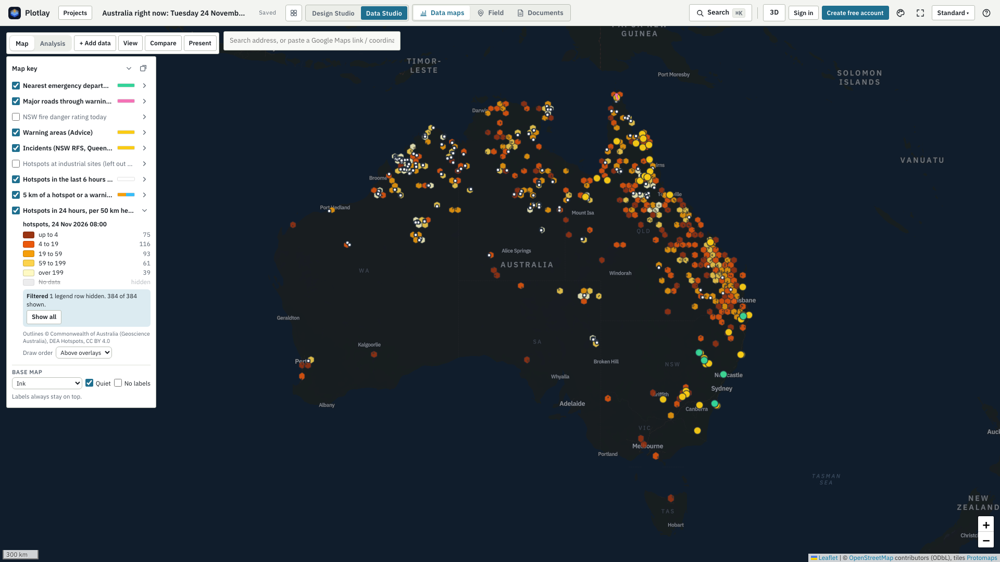

# Australia right now: fire hotspots, incidents and who lives near them

> **Public data at a point in time, not an official warning service. For official warnings, check your state emergency service.**

Six public feeds read once at **8:50 am AEDT on Tuesday 24 November 2026** (7:50 am AEST in Brisbane, 5:50 am AWST in Perth), kept, and set
against the 2021 Census, the road network and the hospitals.

- **25,469** satellite hotspots on land in the 24 hours (DEA Hotspots), 3,903 in the last six hours.
  255 more at industrial sites, landfills and solar farms were left out.
- About **180,381** residents lived within 5 km of one, and 5,409 within 5 km of one in the last six
  hours. One hotspot near Murdoch in Perth accounts for 112,840 of the first figure.
- **7** NSW and Queensland incidents at Advice level had a mapped area; **26,323** residents lived within 5 km of
  them and 45,472 within a 15-minute drive.

Showcase page: https://www.getplotlay.com/showcase/australia-right-now/
Live example in Plotlay: https://app.plotlay.io/?example=australia-right-now
The snapshot in Plotlay: https://app.plotlay.io/?example=australia-right-now-snapshot

## What is here

- `data/`: the snapshot and the tables (see `data/README.md`).
- `python/australia_right_now.ipynb`: a narrated notebook that recomputes the counts, including the residents within 5 km
  from the ABS mesh blocks, which it downloads (about 250 MB).
- `visuals/`: the pictures from Plotlay, 16:9 and 1:1.

## Read it carefully

- A hotspot is a hot pixel seen from space, not a confirmed fire. Satellites see a fire only as they pass.
- Industrial sites are left out by a rule (within 400 m of OpenStreetMap industrial land up to 20 km², landfills and
  solar farms), not by hand.
- Residents are 2021 Census counts spread evenly through each mesh block: where people lived in 2021, not that morning.
- Incidents are New South Wales and Queensland only, as the agencies published them at the snapshot.
- Drive times use OpenStreetMap roads at free-flow speeds; a hospital counts as having an emergency department only
  where OpenStreetMap tags it so.

## Licences

Code MIT (`LICENSE`); data we made CC BY 4.0 (`LICENSE-DATA`); files made from OpenStreetMap ODbL 1.0. Sources and
credits in `NOTICE`. Made with [Plotlay](https://www.getplotlay.com).
